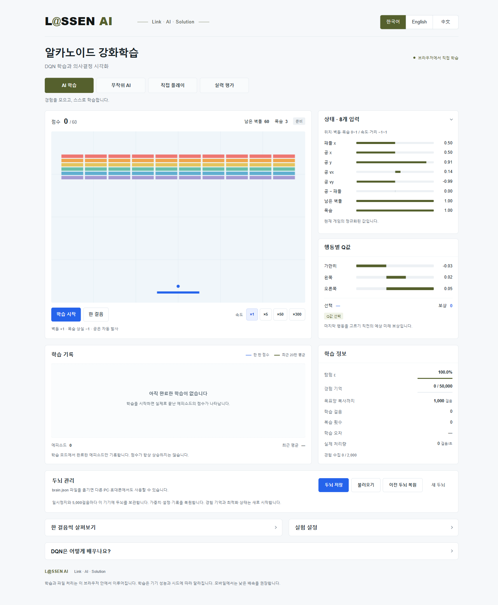

# L@SSEN AI — Breakout Reinforcement Learning

A browser-based Breakout (Arkanoid-style) playground that trains a real Deep Q-Network (DQN), visualizes its decisions, and compares learned behavior with random play.

**Website:** [lassenai.github.io/dqn](https://lassenai.github.io/dqn/) · **Repository:** [lassenai/dqn](https://github.com/lassenai/dqn)

The website becomes available after GitHub Pages is enabled and deployment completes.



## Features

- Real DQN learning with TensorFlow.js in a dedicated Web Worker.
- Four modes: **Train AI**, **Random AI**, **Play yourself**, and **Evaluate**.
- Live state inputs, action Q-values, rewards, exploration, replay memory, loss, and episode-score charts.
- Responsive desktop and mobile layouts; keyboard, press-and-hold touch buttons, and paddle dragging.
- Korean, English, and Simplified Chinese controls, explanations, chart labels, and error messages.
- Download/import `brain.json` to transfer a model between computers and phones.
- No application backend, Python server, account, API key, or runtime CDN required for visitors.

The Korean product name is **알카노이드 강화학습**, under the **L@SSEN AI** brand.

## Open the app through GitHub Pages

After publication, open **https://lassenai.github.io/dqn/** on a PC or mobile browser. Visitors do not need to install Node.js or clone the repository.

To enable publication:

1. Open [Settings → Pages](https://github.com/lassenai/dqn/settings/pages).
2. Under **Build and deployment → Source**, select **GitHub Actions**.
3. Open [Actions](https://github.com/lassenai/dqn/actions) and select **Deploy GitHub Pages**.
4. If needed, click **Run workflow** and choose `main`.
5. Wait for the build and deployment jobs to pass, then open the website link.

The included `.github/workflows/pages.yml` installs dependencies, tests the app, builds it, and publishes `dist/`. Future pushes to `main` trigger deployment automatically. Vite uses relative asset paths so the app, worker, logo, and notebook work under `/dqn/`.

Uploading source to GitHub alone does not run the application on the repository page. GitHub Pages serves the built website. Initial access requires internet; offline caching/PWA support is not included.

## Local development

Use **Node.js 22.12 or newer**.

```sh
git clone https://github.com/lassenai/dqn.git
cd dqn
npm ci
npm run dev
```

Open the URL printed by Vite. To test on a phone during development, connect it to the PC's network and use the printed Network URL. After deployment, use the GitHub Pages URL instead.

```sh
npm test          # Core game and DQN tests
npm run build    # Type checking and production build
npm run preview  # Preview the production build locally
```

`dist/` contains the static website. For local use, open the development/preview URL rather than double-clicking `index.html`.

## Usage

1. Select **한국어 / English / 中文**.
2. In **Train AI**, click **Start training**. The first 2,000 interactions collect experience before gradient updates begin.
3. Choose **×1**, **×5**, **×50**, or **×300**. These are target speeds; actual throughput depends on the device. Lower speeds are recommended on phones.
4. Observe changes in Q-values, exploration, and episode scores. Charts show actual completed training episodes rather than a simulated improvement curve.
5. Select **Evaluate** to compare the current model with random play under matched conditions.
6. Click **Save model** to download `brain.json`, or **Load model** to import one saved by this app.

**Play yourself** supports left/right arrow keys, touch buttons, and dragging on the game board. Manual play runs at ×1 and does not train the network. Switching away from the page pauses execution.

State values describe the current game. Q-values are predictions immediately before the last action. Exploration may select an action other than the one with the highest Q-value.

### Model persistence

The model file includes its format version, rules, state/action order, architecture, weights, settings, training steps, and up to 2,000 recent episode scores.

It does not include the replay buffer, Adam optimizer state, intermediate target-network state, random-generator position, or a running game. Import synchronizes the target network with the online network and collects 2,000 fresh experiences before learning resumes. Continued learning is supported; exact restoration of an entire session is not.

The app stores a local model when training is paused and every 5,000 training steps. **Restore local model** loads that copy. Browser storage is specific to the device, browser, and site origin; it does not synchronize automatically. Transfer the downloaded file to use a model elsewhere.

This app's `brain.json` is not compatible with the reference website's model files or Atari PyTorch `.pt` checkpoints.

## Game environment

- **60 bricks:** 10 columns × 6 rows, matching the reference site's arrangement.
- Three lives, automatic launch, and a limit of 4,500 actions per episode.
- Fixed logical coordinates: **300 × 400**; brick height **8**; paddle/BAR height **5**. Rendering scales independently of physics.
- Actions: stay, left, right. Each action advances four physics frames.
- Reward: **+1** per broken brick and **−1** per lost life.
- Score: broken-brick count, from **0 to 60**.

The eight normalized inputs are paddle x, ball x/y, ball horizontal/vertical velocity, ball–paddle offset, remaining-brick fraction, and remaining-life fraction.

## DQN implementation

A fully connected **8 → 64 → 64 → 3** network uses ReLU, Adam, Huber loss, epsilon-greedy exploration, experience replay, and a separate target network. A hard-coded ball-following policy does not replace the AI.

Default settings:

- Learning rate **0.001**; discount factor γ **0.99**.
- Replay capacity **50,000**; minibatch **32**.
- Collect **2,000** interactions before learning.
- Update every **4** training actions; copy the target network every **1,000**.
- Reduce exploration ε from **1.0 to 0.05** over **80,000** actions.

Replay entries explicitly store `(state, action, reward, nextState, terminal)`. Life loss and true termination stop bootstrapping. Time-limit truncation retains bootstrapping from the recorded next state.

```text
target = reward + γ × (1 − terminal) × max Q_target(nextState, action)
```

TensorFlow.js uses its CPU backend inside a Web Worker. Short scheduling intervals allow commands to be handled during training. Applying new experiment settings resets weights and history.

## Evaluation and validation

Evaluation uses game seeds **9001–9010**, ten games each for the learned and random policies. Learned-policy exploration is disabled. Evaluation updates neither weights nor replay memory and reports mean, maximum, population standard deviation, and clear rate.

Core tests cover seeded reproducibility, collisions, life loss, truncation, Bellman terminal masking, replay wraparound, translation coverage, real weight updates, target copying, model round-trip predictions, and bounded tensor memory.

Browser checks covered 320px, 390px, and 1440px layouts, three languages, keyboard and emulated touch, model download/import, complete evaluation, and a project deployment subpath. Physical-phone testing has not yet been performed.

A limited default-settings run with 100,000 training actions per training seed yielded these ten-game evaluation averages:

- Training seed 1: **8.2 before → 16.0 after**.
- Training seed 2: **8.2 before → 11.4 after**.
- Training seed 3: **8.1 before → 7.1 after**.
- Matched random policy: **6.1**.

Two seeds improved and one declined. These limited results do not guarantee improvement or mastery.

```sh
npm run benchmark
```

The default benchmark uses 20,000 actions and training seeds 1, 2, and 3. For 100,000 actions in PowerShell:

```powershell
$env:BENCHMARK_STEPS = '100000'
npm run benchmark
```

Raw results are written to `benchmark-results.json` locally.

## Project structure

```text
src/game.ts           Seeded game environment and physics
src/dqn.ts            Network, replay, and learning
src/model.ts          Model-file and settings validation
src/worker.ts         Execution modes and evaluation
src/protocol.ts       Worker message types
src/main.ts           Interface, persistence, and charts
src/i18n.ts           Three-language translations
src/style.css         Responsive visual design
tests/                Core tests
scripts/              Reproducible benchmark
public/               Logo, favicon, downloadable notebook
notebook/             Original reference notebook
design/               Concepts and implementation screenshots
.github/workflows/    GitHub Pages deployment
```

## References and credits

The supplied notebook in `notebook/` uses Atari Breakout, four 84 × 84 grayscale frames, a convolutional DQN, PyTorch, and Gymnasium. This project preserves the learning concepts while using a smaller numeric-state environment suitable for browser-side training. A notebook copy is downloadable from the app.

- [AI CITY BUILDERS DQN](https://www.aicitybuilders.com/dqn): educational interaction and brick-arrangement reference. The app's source and model were implemented separately.
- [TensorFlow.js](https://www.tensorflow.org/js): browser machine-learning library.
- [GitHub Pages](https://docs.github.com/en/pages/getting-started-with-github-pages/what-is-github-pages): static hosting.

The L@SSEN AI wordmark and black/olive direction are based on the branding provided for this project.
